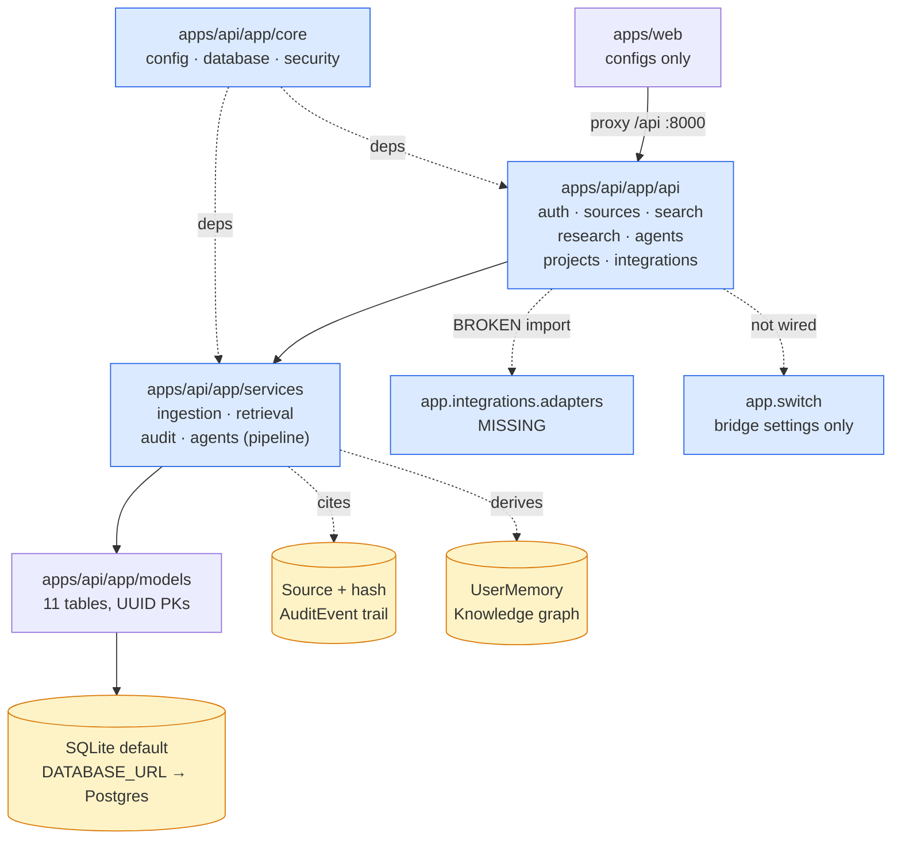

# SecondBrain — CURRENT (Handoff)

**Date:** 2026-11-06
**Branch:** `main` — committed history landing (initial commits in this session).
**Git identity:** `FiscalMindset` (`algsoch@gmail.com`)
**Hackathon:** Switch, Nov 4–7, 2026 — track: **Best Personal or Creative Workflow**
**Current phase:** **Phase 4 (core) complete** — backend, frontend, Switch template, docs, Docker, CI all built and verified.
**Build / test status:** **GREEN (2026-11-06)** — backend: **46 passed, 93% line coverage** (`874 stmts, 58 miss`). Web: `npm run build` passes (38 modules, 198kB JS). `docker compose config` validates. Switch template + CI YAML parse clean.

---

## 1. What SecondBrain Is

SecondBrain is a personal research and knowledge workspace: ingest sources
(notes/URLs/text) with content-hash dedupe, chunk them for keyword retrieval
with citations, run a local multi-agent research pipeline that emits
findings + gaps + contradictions + `human_approval`, and turn findings into
projects/tasks (plus a text-only issue draft). Provenance = `Source` +
content hash + `AuditEvent` trail + citation IDs. Memory = `UserMemory` +
knowledge graph (`KnowledgeEntity` / `KnowledgeRelationship`). Switch is for
**collaboration on knowledge artifacts**, never a chat wrapper (ADR-005).

## 2. Implemented vs Partial vs Not (verified 2026-11-04 against the tree)

### ✅ Implemented (exists, substantive, uncommitted)

| Area | File(s) | Notes |
|---|---|---|
| Config | `apps/api/app/core/config.py` | pydantic-settings; SQLite default, `API_PREFIX=/api`, Switch bridge settings |
| DB engine/session | `apps/api/app/core/database.py` | `get_db` dep, `init_db()` via `create_all` (no Alembic) |
| Auth primitives | `apps/api/app/core/security.py` | PBKDF2 stdlib hashing, HMAC tokens, `require_user` dep |
| Models (10 tables) | `apps/api/app/models/models.py` | `User`, `Source`, `Document`, `KnowledgeEntity`, `KnowledgeRelationship`, `Project`, `ProjectTask`, `ResearchSession`, `AgentExecution`, `AuditEvent`, `UserMemory` = 11 actually |
| Services | `app/services/{ingestion,retrieval,audit,agents}.py` | normalize/fingerprint/chunk; ILIKE retrieval + citations; never-fails audit writer; 9-agent pipeline (`run_orchestration`) |
| Routers (7) | `app/api/{auth,sources,search,research,agents,projects}.py` + `integrations.py` | auth register/login; sources CRUD+dedupe; search; research; agents list/run; projects + tasks + issue-draft; integrations catalogue |
| Frontend configs | `apps/web/{index.html,vite.config.ts,tsconfig.json,package.json}` | Vite proxy `/api → :8000`, React 18, react-router-dom; version 0.1.0 |
| Deps | `apps/api/requirements.txt` | fastapi, uvicorn, sqlalchemy, pydantic(+-settings), httpx, passlib, multipart, pytest, pytest-cov |

### ⏳ Partial

| Area | State |
|---|---|
| `app/api/integrations.py` | Imports `app.integrations.adapters` — **file does not exist**; router would `ImportError` on boot |
| `app/switch/` | `__init__.py` docstring only; Settings has bridge URL/key/agent-id but no client |
| `app/agents/` | `__init__.py` only; orchestration lives in `services/agents.py` (pipeline/research/knowledge/reviewer/project-manager implemented as pure functions) |
| `app/integrations/` | `__init__.py` only; no adapters |
| `apps/web/src/` | `components/`, `hooks/`, `pages/`, `store/` exist, all empty; no `main.tsx` so `npm run build` fails |
| `packages/shared/` | empty |
| `docker/`, `infra/`, `.github/workflows/` | empty |
| `docs/*` (13 dirs) | empty; root doc suite is the only doc content |

### ⬜ Not started

- `app/main.py` — **app factory, router mounting, `GET /health`** (nothing to boot).
- Alembic migrations (DB created via `create_all` today).
- Tests (`apps/api/tests` empty; no Vitest/Playwright at all).
- CI, Docker/compose, Alembic, seed script, OAuth (real keys), Switch client.

## 3. Architecture (actual)



Pipeline verified in `services/agents.py`:
`run_orchestration()` = research → knowledge → reviewer → project-manager,
persisted as `AgentExecution`; agents module advertises 9 agents
(orchestrator, research, knowledge, learning, project-manager, reviewer,
memory, verifier, qa) — but `learning`, `memory`, `verifier`, `qa` have **no
runner functions** yet (only the 4 wired into orchestration exist).

## 4. Repo Structure (actual, 2026-11-04)

```text
secondbrain/                      # branch main · ZERO commits · all files uncommitted
├── apps/api/
│   ├── app/
│   │   ├── agents/__init__.py        # placeholder (pipeline in services/agents.py)
│   │   ├── api/{auth,sources,search,research,agents,projects,integrations}.py
│   │   ├── core/{config,database,security}.py
│   │   ├── integrations/__init__.py  # placeholder — adapters.py MISSING
│   │   ├── models/models.py          # 11 tables
│   │   ├── services/{ingestion,retrieval,audit,agents}.py
│   │   └── switch/__init__.py        # placeholder — no bridge client
│   ├── tests/                        # EMPTY
│   └── requirements.txt
├── apps/web/
│   ├── index.html vite.config.ts tsconfig.json package.json
│   └── src/{components,hooks,pages,store}/   # all EMPTY, no main.tsx
├── packages/shared/                  # EMPTY
├── docker/ infra/ .github/workflows/ # EMPTY
├── docs/{ai,api,architecture/ADR,database,design,devops,engineering,
│         hackathon,integrations,operations,product,security,testing}/  # EMPTY
└── README.md CURRENT.md TODO.md CHANGELOG.md DECISIONS.md KNOWN_ISSUES.md
    DEVELOPMENT_LOG.md RELEASE_NOTES.md docs/README.md  (this suite, uncommitted)
```

## 5. Blockers

| ID | Blocker | Impact | Mitigation / owner |
|---|---|---|---|
| B-01 | **Switch Console manual step** — Switch credentials/console setup require a human | Real Switch features blocked until done; core unaffected | Keep Switch env-gated + stub; do not block Phase 4 on it. Owner: human |
| B-02 | **Real OAuth keys** not provisioned | OAuth login blocked; catalogue preview works (once adapters exist) | Dev on `SECRET_KEY` only; skip integration tests without keys. Owner: human |
| B-03 | **No commits on `main`** — every session's work is uncommitted and could be lost/overwritten | Merge/conflict risk across parallel sessions | SB-FOUND-001 lands the initial commit immediately, including this doc suite + backend |

## 6. Exact Next Tasks (in order)

1. **SB-FOUND-001** — Initial commit of everything in §4 (code + docs) on `main`.
2. **SB-FOUND-002** — Write `app/integrations/adapters.py` (`ADAPTERS`, `describe_contract`) so `app/api/integrations.py` imports; **or** comment the router out until it exists.
3. **SB-FOUND-003** — Write `app/main.py`: app factory, `init_db()`, mount all routers under `settings.API_PREFIX`, add `GET /health`; verify `uvicorn app.main:app` boots (catches the adapters import at once).
4. **SB-TEST-001** — First pytest smoke: register → token → ingest source → search returns citation. Goes in `apps/api/tests/`.
5. **SB-FE-001** — `apps/web/src/main.tsx` + app shell (router, API client, auth context) so `npm run build` passes.
6. **SB-DB-001** — Decide migrations (Alembic) vs `create_all`; SB-DB-001 default is Alembic with Postgres parity. (Today: `create_all` only.)
7. **SB-SWITCH-001** — Switch bridge client per env contract; stub for local dev.
8. **SB-HACK-001** — Seed corpus + 3-minute demo script; keeps working without Switch keys.
9. **SB-DEVOPS-002** — CI workflow (pytest + typecheck/build) — unblocks safe parallel work.

Full detail + statuses: [TODO.md](./TODO.md).

## 7. Docs to Read Before Touching Code

- [README.md](./README.md) — overview, quickstart, architecture.
- [TODO.md](./TODO.md) — backlog, acceptance criteria, test requirements.
- [DECISIONS.md](./DECISIONS.md) — ADRs (modular monolith, SQLite/Postgres, FastAPI, React+Vite, Switch positioning, provenance/memory).
- [docs/README.md](./docs/README.md) — subsystem doc index (fill as phases land).
- [KNOWN_ISSUES.md](./KNOWN_ISSUES.md) — known issues / workarounds.

## 8. Verification Checklist (pending — item 1 is the critical path)

- [ ] `cd apps/api && uvicorn app.main:app --reload` boots (needs SB-FOUND-002/003) — **pending**
- [ ] `cd apps/api && pytest` — pending (tests dir empty)
- [ ] `cd apps/web && npm run typecheck && npm run build` — pending (no `src/main.tsx`)
- [ ] `GET /health` returns 200 — pending (no `main.py`)
- [ ] `POST /api/auth/register` → `GET /api/search?q=…` returns citations — pending

**Do not update §2/§8 to claim "done" until the corresponding command has
been run.** This file is the handoff source of truth; update it in the same
commit that changes the status.
