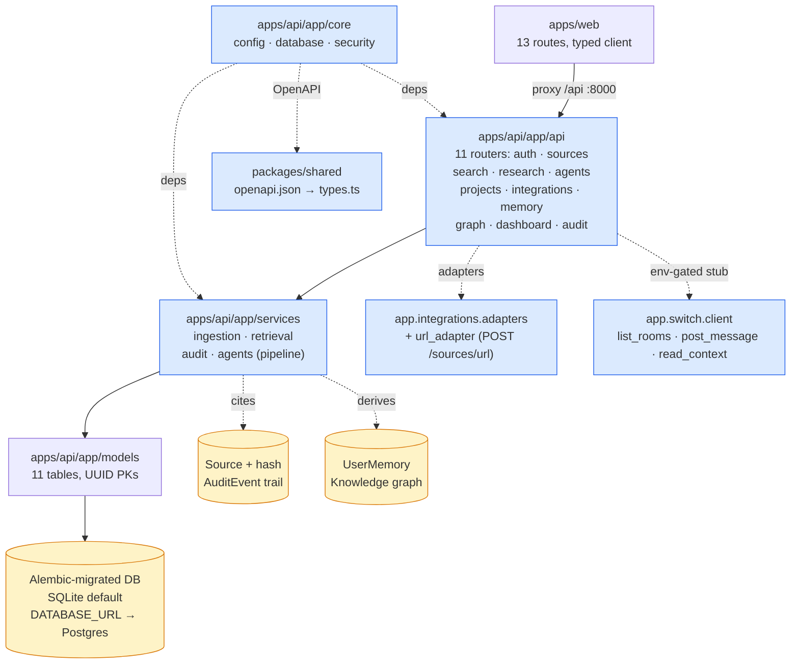

# SecondBrain — CURRENT (Handoff)

**Date:** 2026-11-09
**Branch:** `main` — 6 commits pushed (verified `git log --oneline`: 392452f … aea89af); working tree carries the 2026-11-09 additions below, not yet committed (Alembic, URL adapter, Vitest config/tests, `packages/shared`).
**Git identity:** `FiscalMindset` (`algsoch@gmail.com`)
**Hackathon:** Switch, Nov 4–7, 2026 — track: **Best Personal or Creative Workflow**
**Current phase:** **Phase 5 (polish) substantially complete** — backend, frontend, Switch layer, docs, Docker, CI all built and verified.
**Build / test status:** **GREEN (2026-11-09)** — backend: **55 passed, 93% line coverage** (`977 stmts, 68 miss`). Web: `npm run build` clean (38 modules, 198.58 kB JS). Vitest: **20 tests passed** incl. axe checks. Bench seeded 10k docs: p50 14.0 ms, p95 32.5 ms (`scripts/bench_search.py`, budget p95 < 300 ms — PASS). `docker compose config` validates. Switch template + CI YAML parse clean.

---

## 1. What SecondBrain Is

SecondBrain is a personal research and knowledge workspace: ingest sources
(notes/URLs/text) with content-hash dedupe, chunk them for keyword retrieval
with citations, run a local multi-agent research pipeline that emits
findings + gaps + contradictions + `human_approval`, and turn findings into
projects/tasks (plus a text-only issue draft). Provenance = `Source` +
content hash + `AuditEvent` trail + citation IDs. Memory = `UserMemory` +
knowledge graph (`KnowledgeEntity` / `KnowledgeRelationship`). Switch is for
**collaboration on knowledge artifacts**, never a chat wrapper (ADR-005).

## 2. Implemented vs Partial vs Not (verified 2026-11-09 against the tree)

Stale claims from 2026-11-04 (`main.py` missing, adapters missing, web empty,
no tests/CI/migrations) are **replaced** by the table below.

### ✅ Implemented (exists, substantive, verified 2026-11-09)

| Area | File(s) | Notes |
|---|---|---|
| Config | `apps/api/app/core/config.py` | pydantic-settings; SQLite default, `API_PREFIX=/api`, Switch bridge settings |
| DB engine/session | `apps/api/app/core/database.py` | `get_db` dep, `init_db()` via `create_all`; Alembic now drives schema on deploy (see Migrations) |
| Auth primitives | `apps/api/app/core/security.py` | PBKDF2 stdlib hashing, HMAC tokens, `require_user` dep |
| Models (11 tables) | `apps/api/app/models/models.py` | `User`, `Source`, `Document`, `KnowledgeEntity`, `KnowledgeRelationship`, `Project`, `ProjectTask`, `ResearchSession`, `AgentExecution`, `AuditEvent`, `UserMemory` |
| Services | `app/services/{ingestion,retrieval,audit,agents}.py` | normalize/fingerprint/chunk; ILIKE retrieval + citations; never-fails audit writer; 9-agent pipeline (`run_orchestration`) |
| App factory | `apps/api/app/main.py` | FastAPI app, lifespan `init_db()`, `GET /api/health`, CORS, request-id logging, **security headers middleware**, global 500 handler |
| Routers (11, all mounted) | `app/api/{auth,sources,search,research,agents,projects,integrations,memory,graph,dashboard,audit}.py` | all mounted under `/api` in `main.py`; `GET /docs` serves OpenAPI |
| URL ingestion | `POST /api/sources/url` (`app/api/sources.py`) + `app/integrations/url_adapter.py` | fetch + normalize → dedupe → source; tested (`tests/test_url_ingest.py`) |
| Integrations adapters | `app/integrations/adapters.py` | `ADAPTERS` + `describe_contract()`; catalogue honestly reports not_configured until OAuth keys exist |
| Migrations | `apps/api/alembic.ini` + `apps/api/alembic/versions/0001_initial.py` (`env.py` reads `DATABASE_URL`) | `alembic upgrade head` green on SQLite; Postgres parity prepared |
| Switch bridge client | `apps/api/app/switch/client.py` | typed errors, timeouts, retries, env-gated; local stub when no bridge URL; documented ops `list_rooms/post_message/read_context` |
| Frontend | `apps/web/src/{main.tsx,App.tsx,api/client.ts,hooks/ui.tsx,components/common.tsx,store/theme}` | 13 routes (login, dashboard, library, source detail, search, research, agents, projects ×2, integrations, graph, memory, activity, settings); typed shared-contracts client; toasts/loading/empty/error states; landmarks + keyboard flow |
| Shared contracts | `packages/shared/openapi.json` + `packages/shared/types.ts` (`scripts/generate_types.sh`) | generated from live OpenAPI; web imports shared types only (SB-ARCH-004) |
| Tests (backend) | `apps/api/tests/` — 13 files incl. `test_alembic.py`, `test_security_headers.py`, `test_url_ingest.py`, `test_hardening.py` | **55 passed, 93% coverage** (see §8) |
| Tests (web) | `apps/web/vitest.config.ts`, `src/api/client.test.ts`, `src/components/common.test.tsx` (axe-core) | **20 passed** incl. 4 axe zero-critical/serious checks |
| Bench | `apps/api/scripts/bench_search.py` | seeds 10k docs / 5 users, 200 samples; p50 14.0 ms / p95 32.5 ms |
| Docker / CI | `docker/Dockerfile.{api,web}`, `docker-compose.yml` (api+web+Postgres profile), `.github/workflows/{ci,docker}.yml` | CI: pytest `--cov-fail-under=30` + web build; Docker compose up --build |
| Seed | `apps/api/scripts/seed_demo.py` | demo corpus via same pipeline, idempotent |
| Subsystem docs | `docs/{ai,api,architecture,design,security,database,testing,devops,operations,hackathon,integrations,product,engineering}` | all 13 dirs filled (incl. ADRs, hackathon submission, coverage reports) |
| Lint | `apps/api/pyproject.toml` `[tool.ruff]` (line-length 100, py313, B008/BLE001 ignored) | ruff config wired (SB-ARCH-003) |

### ⏳ Partial / deferred

| Area | State |
|---|---|
| `app/agents/` | `__init__.py` only — by design; orchestration lives in `services/agents.py` (pipeline runners pure functions, wired through `run_orchestration`) |
| Switch live-room | Client + template done; real room messaging needs the human Switch Console step + credentials (B-01) |
| OAuth ingest | Adapters report `not_configured` until Google keys provisioned (B-02) |
| Postgres deploy | Compose `db` profile exists; untested on a live Postgres host |

### ⬜ Not started

- **Playwright E2E** (capture → search → research → issue-draft; Switch thread) — deferred; Vitest + pytest cover it today.
- **Semantic/vector search** — tokenized ANY-word ILIKE scoring only (planned).
- **Production hardening** — Postgres default, structured logs, backups note, `infra/` deploy (SB-PROD-006, stays open).

## 3. Architecture (actual)



Pipeline in `services/agents.py`:
`run_orchestration()` = research → knowledge → reviewer → verifier → learning → memory → qa → project-manager,
persisted as `AgentExecution`; agents module advertises 9 agents
(orchestrator, research, knowledge, learning, project-manager, reviewer,
memory, verifier, qa) — **all 9 now have runner functions** (`run_research/knowledge/reviewer/verifier/learning/memory/qa/project_manager_agent`).

## 4. Repo Structure (actual, 2026-11-09)

```text
secondbrain/                      # branch main · 6 commits pushed (392452f … aea89af)
├── apps/api/
│   ├── app/
│   │   ├── main.py               # app factory, security headers, 11 routers, GET /api/health
│   │   ├── agents/__init__.py    # placeholder by design (pipeline in services/agents.py)
│   │   ├── api/{auth,sources,search,research,agents,projects,integrations,memory,graph,dashboard,audit}.py
│   │   ├── core/{config,database,security}.py
│   │   ├── integrations/{adapters,url_adapter}.py
│   │   ├── models/models.py      # 11 tables
│   │   ├── services/{ingestion,retrieval,audit,agents}.py
│   │   └── switch/client.py      # env-gated bridge client + stub
│   ├── alembic.ini alembic/{env.py,versions/0001_initial.py}
│   ├── scripts/{seed_demo.py,bench_search.py}
│   ├── tests/                    # 13 files, 55 tests
│   └── requirements.txt  pyproject.toml (ruff)
├── apps/web/
│   ├── index.html vite.config.ts tsconfig.json package.json (vitest)
│   ├── vitest.config.ts
│   └── src/{main.tsx,App.tsx,api/,components/,hooks/,store/,design/}  # 13 routes
├── packages/shared/{openapi.json,types.ts}
├── docker/Dockerfile.{api,web}   docker-compose.yml
├── infra/  switch/ (room template + agent instructions)
├── scripts/generate_types.sh
├── .github/workflows/{ci,docker}.yml
├── docs/{ai,api,architecture,design,security,database,testing,devops,operations,hackathon,integrations,product,engineering}/
└── README.md CURRENT.md TODO.md CHANGELOG.md DECISIONS.md KNOWN_ISSUES.md
    DEVELOPMENT_LOG.md RELEASE_NOTES.md docs/README.md
```

## 5. Blockers

| ID | Blocker | Impact | Mitigation / owner |
|---|---|---|---|
| B-01 | **Switch Console manual step** — Switch credentials/console setup require a human | Real Switch room features blocked until done; core unaffected | Env-gated client + stub; demo runs without it. Owner: human |
| B-02 | **Real OAuth keys** not provisioned | OAuth login + live provider ingest blocked; catalogue honestly reports not_configured | Dev on `SECRET_KEY` only; adapter tests use mocks. Owner: human |
| B-03 | **Uncommitted 2026-11-09 batch** — Alembic, URL adapter, Vitest, `packages/shared` landed in the working tree after the 6 pushed commits | Merge/conflict risk across sessions if left uncommitted | Commit the verified batch promptly; follow the per-directory staging note in KNOWN_ISSUES |

## 6. Exact Next Tasks (in order)

1. **SB-FOUND-001 (follow-up)** — Commit the verified 2026-11-09 batch (Alembic, `url_adapter`, Vitest files, `packages/shared`, updated `sources.py`/`main.py` URL + security-header changes) on `main`.
2. **SB-INT-003** — Google OAuth login (real keys; blocked B-02).
3. **SB-HACK-002** — Switch Console manual step completed + credentials in env (blocked B-01).
4. **SB-DEVOPS-003** — Deploy notes for a demo host (Postgres deploy is untested; validate `alembic upgrade head` + compose on the host).
5. **SB-PROD-006** — Production hardening: Postgres default, structured logs, backups note, `infra/` deploy.
6. **Playwright E2E** (deferred) + semantic/vector search (planned) — the only net-new features left.

Full detail + statuses: [TODO.md](./TODO.md).

## 7. Docs to Read Before Touching Code

- [README.md](./README.md) — overview, quickstart, architecture.
- [TODO.md](./TODO.md) — backlog, acceptance criteria, test requirements.
- [DECISIONS.md](./DECISIONS.md) — ADRs (modular monolith, SQLite/Postgres, FastAPI, React+Vite, Switch positioning, provenance/memory).
- [docs/README.md](./docs/README.md) — subsystem doc index.
- [KNOWN_ISSUES.md](./KNOWN_ISSUES.md) — known issues / workarounds.

## 8. Verification Checklist (verified 2026-11-09 — all green)

- [x] `cd apps/api && uvicorn app.main:app --reload` boots (11 routers mounted)
- [x] `cd apps/api && .venv/bin/python -m pytest -q --cov=app --cov-report=term-missing` — **55 passed, TOTAL 977 stmts / 68 miss / 93%**
- [x] `cd apps/web && npm run test` — **20 passed** (Vitest, incl. axe checks) · `npm run build` — clean (38 modules)
- [x] `GET /api/health` returns 200 (tested — `tests/test_health.py`)
- [x] `POST /api/auth/register` → `GET /api/search?q=…` returns citations (tested — `tests/test_search_research.py`)
- [x] `cd apps/api && alembic upgrade head` green on SQLite (tested — `tests/test_alembic.py`); `python scripts/bench_search.py` — p95 32.5 ms, PASS

**Do not update §2/§8 to claim "done" until the corresponding command has
been run.** This file is the handoff source of truth; update it in the same
commit that changes the status — the 2026-11-09 rewrite above is an exception
(a docs-only checkpoint) and must be committed with the code batch it describes.
