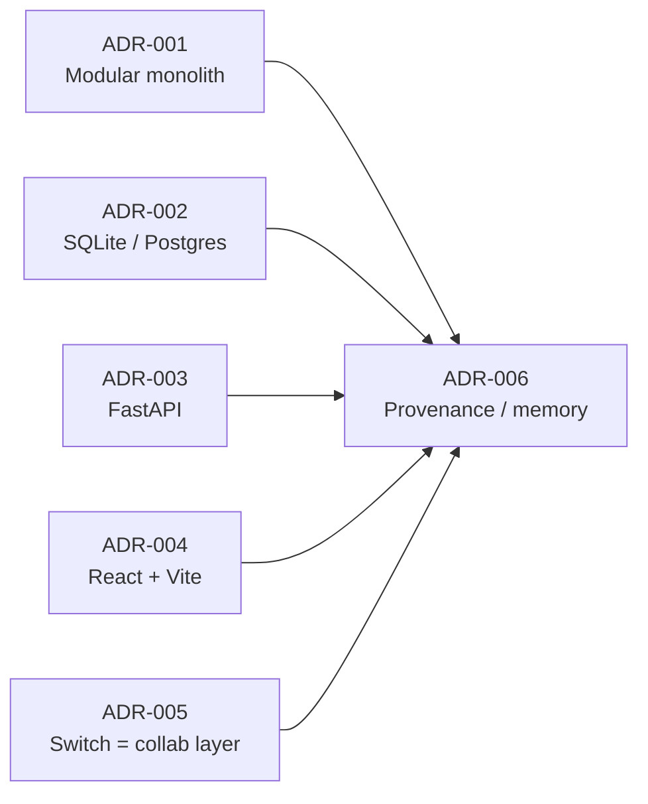

# Architecture Decision Records

**Date:** 2026-11-04 · **Status of this file:** baseline — each ADR below is
*Accepted* for the hackathon build unless marked otherwise. ADR-003…
ADR-004 reflect the stack actually present in `apps/api/requirements.txt`
and `apps/web/package.json`.

---

## ADR-001 — Modular Monolith

**Status:** Accepted (2026-11-04)

**Context:** Single small team, hackathon deadline (Nov 4–7, 2026), need
fast iteration without microservice overhead.

**Decision:** One deployable (FastAPI) + one web app, with explicit modules
inside `apps/api/app/`: `core`, `api`, `services`, `models`, plus
`agents`/`switch`/`integrations` as bounded layers. Rule: `api →
services → models`; `switch` and `integrations` are only reachable via
`services`/`api`. Agent orchestration currently lives in
`services/agents.py` (the `app/agents/` package is a placeholder for
future extraction).

**Consequences:** Simple local dev (`uvicorn` + `npm run dev`), single CI
pipeline, easy extraction of `switch`/`agents` later. Requires discipline
to keep module imports clean (SB-ARCH-003).

---

## ADR-002 — SQLite for Dev, Postgres for Production

**Status:** Accepted (2026-11-04)

**Context:** Needs local-first, zero-config dev and a credible production
database. Today `DATABASE_URL` defaults to
`sqlite:///./secondbrain.db` and the app creates tables via
`Base.metadata.create_all` (`init_db()`).

**Decision:** SQLAlchemy for both dialects. Dev/tests on SQLite;
`docker compose` + production on Postgres via `DATABASE_URL`. Harden with
Alembic migrations (SB-DB-001) so schema changes are versioned and
Postgres parity is tested — `create_all` remains the dev today only, never
the production path. No dialect-specific features in models (portable
types; search stays ILIKE in the service layer, SB-AI-001).

**Consequences:** Fast onboarding, easy CI. Dialect drift is the risk —
mitigated by portable models + dual-dialect migration smoke.

---

## ADR-003 — FastAPI (Python 3.12)

**Status:** Accepted (2026-11-04) — implemented in code, pending entrypoint

**Context:** Typed, fast iteration, OpenAPI for free, pydantic settings,
async-ready. Dependencies verified in `apps/api/requirements.txt`:
`fastapi>=0.110`, `uvicorn`, `sqlalchemy>=2.0`, `pydantic>=2`,
`pydantic-settings>=2`, `httpx`, `python-multipart`, `pytest`/`pytest-cov`.

**Decision:** FastAPI + pydantic-settings on Python 3.12. `app/main.py`
(SB-BE-004, pending) mounts the 7 routers (`auth`, `sources`, `search`,
`research`, `agents`, `projects`, `integrations`) under
`settings.API_PREFIX` (`/api`), calls `init_db()`, and serves OpenAPI at
`/docs`. Passwords use PBKDF2-HMAC-SHA256 (120k rounds) and tokens are
stdlib HMAC — passlib is pinned only as a compatibility dep.

**Consequences:** OpenAPI contract drives `packages/shared` types
(SB-ARCH-004). Pydantic v2 validation at the edge; services stay
framework-agnostic and testable.

---

## ADR-004 — React + Vite (TypeScript)

**Status:** Accepted (2026-11-04) — configs landed, source pending

**Context:** Need a fast SPA for capture/search/detail plus Switch
collaboration UI. Verified in `apps/web/package.json`: React 18.3,
`react-router-dom`, Vite 5, `@vitejs/plugin-react`, TypeScript (strict).
`vite.config.ts` proxies `/api → http://localhost:8000` for dev and
preview, so the API URL never hard-codes a port.

**Decision:** React+Vite+TS in `apps/web/`. `index.html` bootstraps the
theme from `localStorage` before first paint. `src/main.tsx`, pages,
components/hooks/store (SB-FE-001, pending) will provide: app shell,
typed API client (JWT header from the auth router), auth context,
capture/search/research/projects views.

**Consequences:** Fast HMR dev loop, strong typing once
`packages/shared` is filled, easy component testing. Bundle and a11y
budgets tracked (SB-A11Y-001, SB-PERF-001).

---

## ADR-005 — Switch Is the Collaboration Layer, Not a Chat Wrapper

**Status:** Accepted (2026-11-04)

**Context:** Hackathon platform is Switch. Risk: building "a chat app with
notes attached" and failing the Best Personal or Creative Workflow
criteria.

**Decision:** SecondBrain's core is capture → retrieve with citations →
plan (sources → search → research/agents → projects, all in
`app/api/` + `app/services/`). Switch supplies **teamwork around durable
artifacts**: per-source threads, @mentions, activity feed, notifications,
shared collections. The knowledge record never lives in chat; threads
reference `Source`/`Document` IDs. Switch sits behind `app/switch/` behind
an env gate (`SWITCH_BRIDGE_URL`/`SWITCH_API_KEY`/`SWITCH_AGENT_ID` in
`core/config.py`) with a local stub — core workflows pass with no Switch
keys.

**Consequences:** Strong hackathon narrative (collaboration on knowledge,
not messaging), resilient demo (stub covers Switch outages), contained
integration risk. Real Switch client is blocked on the Switch Console
manual step (B-01, SB-SWITCH-002/SB-HACK-002).

---

## ADR-006 — Provenance / Memory Separation

**Status:** Accepted (2026-11-04) — implemented in the model layer

**Context:** AI summaries and shared memory are only trustworthy if every
claim can be traced to a source. Mixing "where it came from" with "what we
remember" breaks auditability.

**Decision:** Two stores, modelled in `app/models/models.py`:

| Store | Contents | Rule |
|---|---|---|
| **Provenance** | `Source` (kind, url, `content_hash`, content) + chunked `Document`s + `AuditEvent` trail (never raises, never breaks the request path) + citation objects (`document_id`, `source_id`, `chunk_index`) | Append-only evidence; identical content dedupes by hash |
| **Memory** | `UserMemory` (key/value per user) + knowledge graph (`KnowledgeEntity`, `KnowledgeRelationship`) + agent outputs (`AgentExecution`, `ResearchSession`) | References provenance IDs; every agent output carries `human_approval` so a UI gates side effects |

Every retrieval and research response includes citation IDs (SB-AI-002
asserts citation coverage in tests).

**Consequences:** Trustworthy recall and demos ("show me where that came
from"), clean seed/rebuild story (SB-DB-002), slightly more write-path
work on capture (SB-CORE-001).
