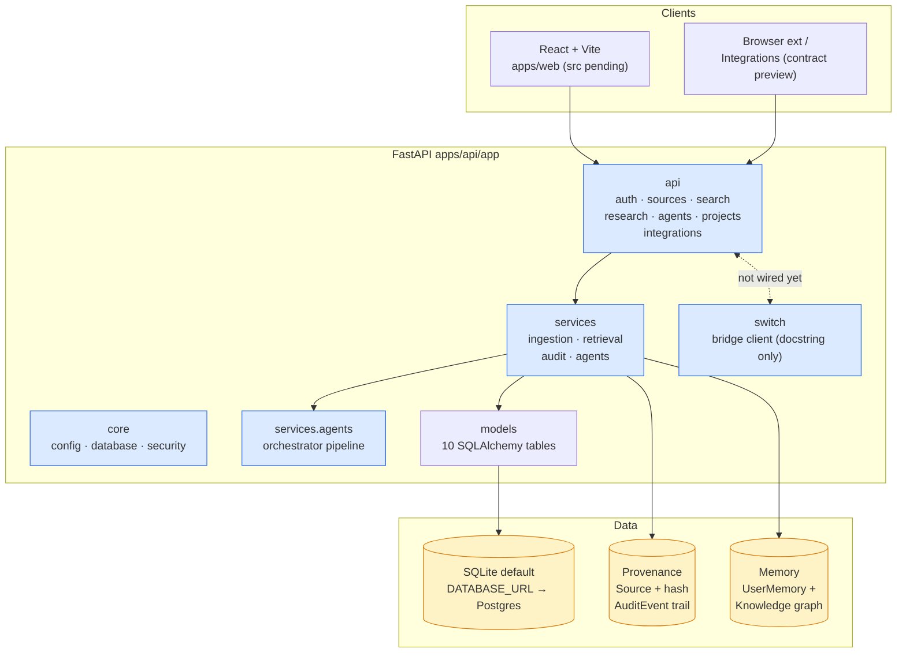

# SecondBrain

[](./CURRENT.md)
[](./CURRENT.md)
[](./CURRENT.md)
[](./CURRENT.md)
[](./CHANGELOG.md)

> A personal research and knowledge workspace: capture sources, turn them
> into cited, queryable knowledge, and let a local multi-agent pipeline
> turn research into projects — with provenance you can trust.

SecondBrain is a **modular monolith**: a FastAPI backend (`apps/api`) and a
React + Vite frontend (`apps/web`) sharing contracts via `packages/shared`,
with a clear separation between **provenance** (where a claim came from:
`Source` + content hash + `AuditEvent` trail + citation IDs) and **memory**
(what the system remembers: `UserMemory` + the knowledge graph). It is
designed for the Switch hackathon (Nov 4–7, 2026) in the **Best Personal or
Creative Workflow** track.

## Hackathon — Switch Statement

SecondBrain enters the Switch hackathon (Nov 4–7, 2026) targeting **Best
Personal or Creative Workflow**.

**Switch is a collaboration layer, not a chat wrapper.** In SecondBrain,
Switch provides the teamwork primitives around knowledge: threaded
discussion on sources, @mentions, activity feeds, notifications, and shared
collections. The core workflow — capture → retrieve with citations → plan
into projects — runs whether or not Switch is configured. Chat is never the
product; collaboration on durable knowledge artifacts is.

Submission readiness, demo script, and manual console steps are tracked in
[TODO.md](./TODO.md) (`SB-HACK-*`) and [KNOWN_ISSUES.md](./KNOWN_ISSUES.md).

## What SecondBrain Does

- **Capture** sources (notes, URLs, text) with content-hash deduplication —
  identical content returns the existing source instead of a duplicate.
- **Chunk & index** each source into `Document` rows for retrieval, keeping
  the source record as the provenance root.
- **Search with citations** (`/api/search`) — keyword retrieval plus
  per-hit citation objects (`document_id`, `source_id`, `chunk_index`).
- **Research via agents** (`/api/research`, `/api/agents`) — an in-process
  multi-agent pipeline (research → knowledge → reviewer → project-manager,
  plus learning, memory, verifier, qa, orchestrator) that keeps the
  `human_approval` flag in every structured output.
- **Plan** findings into projects and tasks, including a text-only
  GitHub-style issue draft (`/api/projects/{id}/issue-draft`).
- **Audit** every mutation through `AuditEvent`, which never breaks the
  request path if writing fails.

> See [CURRENT.md](./CURRENT.md) for the handoff snapshot (what is / is not
> implemented as of 2026-11-04) and [DECISIONS.md](./DECISIONS.md) for ADRs.

## Quickstart

**Prerequisites:** Git, Python 3.12, Node 20+, Docker (optional).

```bash
git clone https://github.com/FiscalMindset/secondbrain.git
cd secondbrain
git checkout main

# --- Backend (FastAPI) ---
cd apps/api
python3.12 -m venv .venv && source .venv/bin/activate
pip install -r requirements.txt
# .env is optional — defaults (SQLite, dev secret) work out of the box.
uvicorn app.main:app --reload --port 8000
```

> ⚠️ `app/main.py` (app factory + router wiring + `GET /health`) is the top
> uncommitted task — see [CURRENT.md](./CURRENT.md) §6. Until it lands there
> is no service to start; the core, models, services and routers below exist
> and are the pieces it will mount.

**Frontend (React + Vite) — configs staged, source pending:**

```bash
cd ../../apps/web
npm install
npm run dev              # http://localhost:5173 (proxies /api → :8000)
```

> `src/main.tsx` and all pages are not written yet (SB-FE-001); the Vite
> config and `index.html` already expect it.

**Env (`apps/api/.env`, optional; defaults are dev-safe):**

```env
DATABASE_URL=sqlite:///./secondbrain.db
SECRET_KEY=dev-only-change-me
API_PREFIX=/api
SWITCH_BRIDGE_URL=
SWITCH_API_KEY=
SWITCH_AGENT_ID=
```

**Verify (once SB-TEST-001 / main.py land):** `http://localhost:8000/docs`
(API) and `http://localhost:5173` (web); `pytest` in `apps/api`,
`npm run build` + `npm run typecheck` in `apps/web`.

## Architecture

Modular monolith with explicit domain modules; Switch and AI are integrated
as bounded layers, not cores.



**Key seams:**

- `app/switch/` — Switch collaboration layer; currently a docstring and
  env settings (`SWITCH_BRIDGE_URL/API_KEY/AGENT_ID`) with no client code.
- `app/services/agents.py` — in-process pipeline, no external LLM calls;
  every output carries `human_approval` and citation IDs.
- Provenance vs memory: `Source` (kind/url/content_hash) + chunks + audit
  trail are append-only evidence; `UserMemory` and `KnowledgeEntity` /
  `KnowledgeRelationship` are the derived, user-scoped memory.

## Repo Structure

```text
secondbrain/                       # branch main · no commits yet (2026-11-04)
├── apps/
│   ├── api/
│   │   ├── app/
│   │   │   ├── agents/            # __init__ only (logic lives in services/agents.py)
│   │   │   ├── api/               # routers: auth, sources, search, research, agents, projects, integrations
│   │   │   ├── core/              # config.py, database.py, security.py (DONE)
│   │   │   ├── integrations/      # __init__ only — adapters.py MISSING (integrations router breaks)
│   │   │   ├── models/            # models.py — 10 tables (DONE)
│   │   │   ├── services/          # ingestion.py, retrieval.py, audit.py, agents.py (DONE)
│   │   │   └── switch/            # __init__ only (bridge settings in core/config.py)
│   │   ├── tests/                 # empty (pytest in requirements.txt; files pending)
│   │   └── requirements.txt
│   └── web/
│       ├── index.html vite.config.ts tsconfig.json package.json  (DONE)
│       └── src/                   # main.tsx + components/hooks/pages/store EMPTY
├── packages/shared/               # empty (OpenAPI-derived types pending)
├── docker/ infra/                 # empty
├── docs/                          # subsystem docs (see docs/README.md)
├── .github/workflows/             # empty
└── README.md CURRENT.md TODO.md CHANGELOG.md DECISIONS.md
    KNOWN_ISSUES.md DEVELOPMENT_LOG.md RELEASE_NOTES.md
```

## Living Docs

| Doc | Purpose |
|---|---|
| [CURRENT.md](./CURRENT.md) | Handoff: implemented vs partial vs not, blockers, next tasks. |
| [TODO.md](./TODO.md) | Master backlog (`SB-*` IDs), acceptance criteria, test requirements. |
| [CHANGELOG.md](./CHANGELOG.md) | Version history. |
| [DECISIONS.md](./DECISIONS.md) | Architecture Decision Records. |
| [KNOWN_ISSUES.md](./KNOWN_ISSUES.md) | Known issues and workarounds. |
| [DEVELOPMENT_LOG.md](./DEVELOPMENT_LOG.md) | Dated development log. |
| [RELEASE_NOTES.md](./RELEASE_NOTES.md) | Release notes / submission notes. |
| [docs/README.md](./docs/README.md) | Index of subsystem docs. |

## Status

- **Branch:** `main` · **Git identity:** `FiscalMindset` · **Date:** 2026-11-04
- **Phase:** Phase 3 (foundation) in progress + Phase 4 (core) starting —
  backend core/modules landed uncommitted; no entrypoint, tests, CI or
  frontend source yet (see [CURRENT.md](./CURRENT.md)).
- **Build/tests:** pending — `pytest` configured in requirements but
  `apps/api/tests` is empty; `vite build` would fail on missing
  `src/main.tsx`.

## License

MIT.
