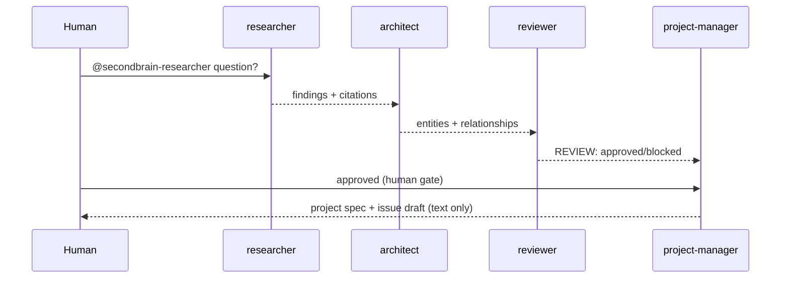

# Switch Architecture

Switch is **mandatory**, not decorative: the hackathon demo (RAG → project spec) runs as an `@`-mention chain in a Switch room (`switch/secondbrain-room.template.yaml`):

Backend bridge: `apps/api/app/switch/client.py` — only documented ops (`list_rooms`, `post_message`, `read_context`, `send_message` via `POST /agents/{id}/messages`, `POST /agents` register), bearer auth, `X-Switch-Connection-Id` header passthrough for room-bound calls, retry-once on 5xx/429, `SwitchError` on failure. The websocket URL is returned for the caller to dial; the API process never opens sockets.

Why the hackathon still works without Switch: the web UI runs the identical 8-step pipeline in-process (`/api/research`), so the workflow is demonstrable either way — but submission requires the Switch room.
